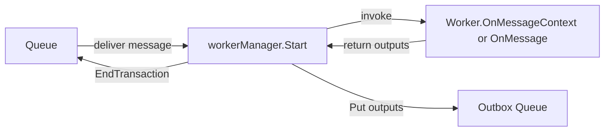
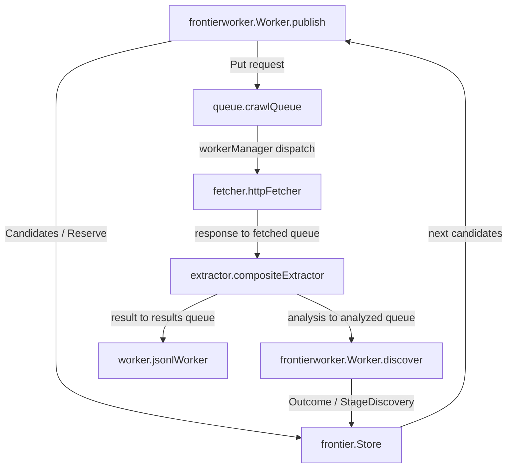

# Architecture

## Application lifecycle

`application.Decode` and `application.Load` apply defaults, parse durations, and validate configuration without starting a crawl. `application.Run(ctx, app)` constructs resources and workers, prepares consumed queues, starts workers and optional services, and waits for cancellation or a service error. A workspace can execute multiple independent crawl pipelines. Register custom factories before starting it.

The CLI registers SIGINT/SIGTERM cancellation before running. Shutdown stops worker pools and job timers, preserves unfinished queue records, closes queues and storage, and stops the API server. `shutdown_timeout` bounds the wait. Shared injected resources belong to the application; worker completion must not close them.

## Execution through the worker classes

For a fresh message, each `workerManager` invokes the worker, stages and publishes its outputs, then acknowledges the input. A recovered delivery with a staged output batch replays that batch instead of invoking the worker again. `jobManager` uses the same manager around timer messages.

## Crawl execution path

The guided crawl uses these concrete worker implementations. Queue handoffs between workers use the manager path above.

Workers consume message envelopes containing an ID, numeric `message_type`, JSON payload, and retry count. Fetch requests have a request ID, URI, origin, host, protocol, and depth. Fetch responses add effective URI, HTTP status, headers, elapsed time, error/success information, body key, and content hash. Analyses add a feature map and optional extractor errors.

## Crawl state and delivery

A `crawl_queue` stores URL state in Badger, namespaced by `crawl_id`. HTTP/HTTPS URLs are normalized by host case, empty path, and removal of fragments. Query parameters remain significant. Records move through pending, leased, completed, or failed states. Startup restores leased records to pending. Successful fetch delivery completes the URL; downstream queues independently preserve extraction and discovery work. `recrawl_after` allows completed URLs to be scheduled again when rediscovered or republished.

File and crawl queues stage each worker's serialized output batch before sending it. A retry reuses that batch rather than recomputing it. Output IDs are deterministic from the input identity and batch position. Only successful required publication permits input acknowledgment. A partially published batch can replay already accepted outputs; exact request queues and stable Elasticsearch document IDs tolerate that replay. JSONL sinks can contain duplicates.

This is at-least-once delivery, not a transaction spanning every resource. Side effects inside a custom worker can run again if the process fails before its result is staged. Use idempotent operations or return explicit messages for downstream processing.

## Body lifetime

The fetcher writes bodies through temporary files and computes an MD5 content fingerprint. A complete body becomes visible only after the write succeeds. Extraction opens an independent reader for each extractor. It retains the body until its output has been accepted and the input acknowledged, then removes it through `MessageCommitter`.

Before startup, queues report body references and the filesystem store removes unreferenced UUID objects and interrupted temporary writes. If a queue cannot be inspected safely, reconciliation is skipped rather than deleting possibly needed objects. Failed fetch responses have no body and still produce metadata analyses.

## Extraction and policies

The composite worker constructs extractors once, validates dependencies, and executes independent dependency stages concurrently. Each extractor receives a separate feature-map snapshot. Feature loading performs JSON conversion without changing the source map. Optional errors are recorded; URL-extraction failures prevent successful discovery processing.

HTML links use a tokenizer, resolve against the effective response URL and HTML base element, and deduplicate after resolution. HTTP scope and robots checks also apply to redirects. Robots requests bypass the page policy to avoid recursively requesting robots rules.

Plain text stripping and mention detection are general heuristics, not an article parser or named-entity model. Sentiment uses the English title and writes `binary_naive_bayes_title`. Other sentiment fields are not populated by the built-in extractor.

## Runtime ownership

Workspace owns saved definitions, desired state, revisions, settings, and operation records in its versioned registry. Mutations serialize per crawl; command IDs are idempotent and stale revisions fail. Accepted operations interrupted by a process restart are reported as failed. A run retains its immutable original configuration snapshot.

Supervisor executes lifecycle commands and exposes runtime snapshots. It has no separate configuration editor or operation journal. Final metrics are captured after workers finish. Shutdown retains exclusive ownership until resources close; a close failure prevents replacement from opening the same data.

Guided definitions and custom pipeline JSON use one preparation path. Contextual constructor registration adapts legacy factories and resolves dependencies. Named optional capabilities describe metrics, admission, pause, activity, and health. Custom worker/resource parameters and large JSON integers survive editor round trips.

Execution limits belong to one workspace broker. Per-crawl controllers apply local bounds, host pacing, and admission gates. The broker enforces aggregate process and host ceilings without cancelling requests when limits are lowered. See [fetch throughput](fetch-throughput.md).

Legacy singleton crawler routes, dashboard persistence, and the streaming listener are removed. The one-time importer retains supported pipeline storage and imports old operation records. Explicit unsupported streaming destinations fail migration.

Pause stops job publication and new dispatch from durable inboxes, waits for admitted deliveries to finish, then pauses workers. Pending durable records do not need to drain. Resume starts consumers before dispatch. Pipelines containing channel or custom inboxes without dispatch control retain queue-draining pause behavior.
