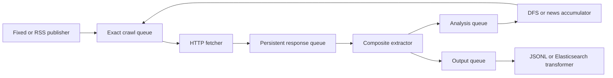

# Architecture

## Application lifecycle

`application.Decode` and `application.Load` apply defaults, parse durations, and validate configuration without starting a crawl. `application.Run(ctx, app)` constructs resources and workers, prepares consumed queues, starts workers and optional services, and waits for cancellation or a service error. A process has one active configuration; register custom factories before starting it.

The CLI registers SIGINT/SIGTERM cancellation before running. Shutdown stops worker pools and job timers, preserves unfinished queue records, closes queues and storage, and stops the API and streaming servers. `shutdown_timeout` bounds the wait. Shared injected resources belong to the application; worker completion must not close them.

## Pipeline

Workers consume message envelopes containing an ID, numeric `message_type`, JSON payload, and retry count. Fetch requests have a request ID, URI, origin, host, protocol, and depth. Fetch responses add effective URI, HTTP status, headers, elapsed time, error/success information, body key, and content hash. Analyses add a feature map and optional extractor errors.

## Crawl state and delivery

A `crawl_queue` stores URL state in Badger, namespaced by `crawl_id`. HTTP/HTTPS URLs are normalized by host case, empty path, and removal of fragments. Query parameters remain significant. Records move through pending, leased, completed, or failed states. Startup restores leased records to pending. Successful fetch delivery completes the URL; downstream queues independently preserve extraction and discovery work. `recrawl_after` allows completed URLs to be scheduled again when rediscovered or republished.

File and crawl queues stage each worker's serialized output batch before sending it. A retry reuses that batch rather than recomputing it. Output IDs are deterministic from the input identity and batch position. Only successful required publication permits input acknowledgment. A partially published batch can replay already accepted outputs; exact request queues and stable Elasticsearch document IDs tolerate that replay. JSONL sinks can contain duplicates.

This is at-least-once delivery, not a transaction spanning every resource. Side effects inside a custom worker can run again if the process fails before its result is staged. Use idempotent operations or return explicit messages for downstream processing.

## Body lifetime

The fetcher writes bodies through temporary files and computes an MD5 content fingerprint. A complete body becomes visible only after the write succeeds. Extraction opens an independent reader for each extractor. It retains the body until its output has been accepted and the input acknowledged, then removes it through `MessageCommitter`.

Before startup, queues report body references and the filesystem store removes unreferenced UUID objects and interrupted temporary writes. If a queue cannot be inspected safely, reconciliation is skipped rather than deleting possibly needed objects. Failed fetch responses have no body and still produce metadata analyses.

## Extraction and policies

The composite worker constructs extractors once, validates dependencies, and executes independent dependency stages concurrently. Each extractor receives a separate feature-map snapshot. Feature loading performs JSON conversion without changing the source map. Optional errors are recorded; URL-extraction failures prevent successful discovery processing.

HTML links use a tokenizer, resolve against the effective response URL and HTML base element, and deduplicate after resolution. HTTP scope and robots checks also apply to redirects. Robots requests bypass the page policy to avoid recursively requesting robots rules.

Plain text stripping and mention detection are general heuristics, not an article parser or named-entity model. Sentiment uses the English title and writes `binary_naive_bayes_title`. Other sentiment fields are not populated by the built-in extractor.

## Supervised operations

The CLI uses a supervisor when the API is enabled; API-disabled runs and `application.Run` retain the original lifecycle. The supervisor owns a locked operations-state file and serializes durable commands independently from dashboard persistence. Its optional worker pause/activity and queue recovery/status interfaces do not change the existing worker and queue contracts. Message envelopes may include `last_error` to explain failed delivery; replay clears that diagnostic and resets retry eligibility while retaining the message ID and staged outputs.
